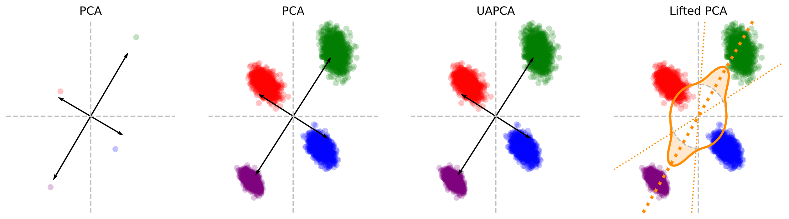

# Lifting PCA in the Wasserstein Space

This repository contains the code to reproduce the experiments [Lifting PCA in the Wasserstein Space](https://arxiv.org/abs/2610.). In this paper, we lift PCA to the Wasserstein space using the lifting procedure from (Savaré and Sodini, 2022) and (Lavenant, 2024). 

Let $\nu_1,\dots,\nu_n \in \mathcal{P}(\mathbb{R}^d)$ be the dataset. Define for all $i\in\{1,\dots,n\}$, $\bar{\nu}_i=T_{\bar{m}\sharp}\nu_i$ where $T_{\bar{m}}(x)=x-\bar{m}$ and $\bar{m}=\frac1n\sum_{i=1}^n m_i$ with $m_i=\int x\ d\nu_i(x)$. One of the formulation of the Lifted PCA problem is a Wasserstein berycenter $\min_{\vartheta\in \mathcal{P}(\mathrm{St}(q,d))}\ \frac1n\sum_{i=1}^n W_c(\bar{\nu}_i, \vartheta)$ with cost $c(x,U)=\|x-UU^\top x\|^2$ for $x\in\mathbb{R}^d, U\in \mathrm{St}(q,d)$. We solve it using the fixed-point solver from (Tanguy et al, 2024), using the implementation of [POT](https://pythonot.github.io/gen_modules/ot.lp.html#ot.lp.free_support_barycenter_generic_costs).




## Abstract

Principal Component Analysis (PCA) is one of the fundamental tools for statistical dimension reduction. Nevertheless, no canonical extension of PCA to distribution-valued data has emerged within the framework of optimal transport. While Wasserstein barycenters and Wasserstein least-squares regression have recently been shown to arise as canonical liftings in the Wasserstein space of Euclidean averaging and standard linear regression, an analogous lifting principle for PCA has not been considered so far. In this paper, we introduce Lifted PCA, a canonical extension of Euclidean PCA to the Wasserstein space obtained through the framework of lifting functionals in the space of probability measures by convex extension. Starting from the classical variational formulations of PCA on the Stiefel and Grassmann manifolds, we derive two equivalent minimization problems over probability measures supported on these manifolds that correspond to Wasserstein barycenters with generalized costs. We prove that these formulations are linked by an exact analogue of the equivalence between the Stiefel and Grassmann formulations of Euclidean PCA, thereby preserving the original variational structure of PCA on these manifolds after lifting. Building upon the generalized Wasserstein barycenter problem, our analysis further shows that Lifted PCA admits dual formulations and optimality conditions for its characterization, as well as equivalent multimarginal optimal transport and matching-for-teams formulations. We also establish statistical consistency for empirical estimators and develop computational algorithms based on the Wasserstein barycenter formulation over the Stiefel manifold. Our results show that while Euclidean PCA summarizes a collection of vectors by projections onto an optimal low-dimensional linear subspace, Lifted PCA summarizes a collection of probability distributions using an optimal probability measure supported on multiple low-dimensional subspaces. Numerical experiments on distributional datasets illustrate the practical performance of the proposed methodology and its benefits for distributional data analysis.


## Citation

```
@article{bigot2026lifting,
    title={{Lifting PCA in the Wasserstein Space}},
    author={Jérémie Bigot and Clément Bonet},
    year={2026},
    journal={arXiv preprint arXiv:2610.}
}
```

## Description of the code

The main class is `LiftedPCA`, which can be found in `lib_pca/lifted_pca.py`. It follows the scikit-learn API. The initialization takes as arguments the dimension of the subspace and the number of subspaces $U_i$ for the distribution $\vartheta=\frac1p\sum_{i=1}^p \delta_{U_i} \in \mathcal{P}(\mathrm{St}(q,d))$. Then, the data can be fitted either using a list of distributions using the method `fit`, or using a tensor with all the samples and a list of labels using the method `fit_from_labels`. Once fitted, the distribution $\vartheta$ can be accessed through `lifted_pca.components_`. By default, our solver only optimizes over the support. We also allow for optimizing over weights with fixed support using a Mirror Descent or alternating between the two algorithms, but observe worse results for these solvers. We also provide the code of Uncertainty Aware PCA (UAPCA) in `lib_pca.uncertainty_aware_pca.py` also following the scikit-learn framework.

Below, we give an example of syntax. More tests can be found in the notebook `Illustration_LiftedPCA.ipynb`. 

```
import torch
from lib_pca.lifted_pca import LiftedPCA
from lib_pca.utils_sqrtm import sqrtm

## Create the dataset of 4 distributions, with 1000 points in each distribution
m1, m2, m3, m4 = [-1., 1.], [1., -1.], [1.5, 2.], [-1.5, -2.]
means = torch.tensor([m1, m2, m3, m4])

Sigma0 = torch.tensor([[1, -0.5], [-0.5, 1]])
Sigma1 = torch.tensor([[1, -0.5], [-0.5, 1]])
Sigma2 = torch.tensor([[1, -0.4], [-0.4, 2.4]])
Sigma4 = 0.5 * torch.tensor([[1, -0.5], [-0.5, 1]])

s = 0.05

Sigmas = s * torch.stack([Sigma0, Sigma1, Sigma2, Sigma4])

n = 1000
d = 2
samples = torch.zeros((len(means), n, d))
for k in range(len(means)):
    samples[k] = means[k] + torch.randn(n, d) @ sqrtm(Sigmas[k])

## Initialize LiftedPCA with q=1, p=50
lifted_pca = LiftedPCA(n_components=1, n_samples=50)

## Solve LiftedPCA using the fixed-point solver
lifted_pca.fit(samples, solver="fixed_weights")

## Get the barycenter, and the value of the objective
barycenter = lifted_pca.components_
print("Value objective:", lifted_pca.cost_barycenter(samples).item())
```


## Experiments

- Figure 1 can be reproduced by running the notebook `Illustration_LiftedPCA.ipynb`.
- Figures 3 and 4 can be reproduced by running the notebook `xp_2d/xp_2d.ipynb`.
- Figures 5 and 6 can be reproduced by running the notebooks in the folder `xp_datasets`.


## Credits

- G. Savaré and G. E. Sodini, *A Simple Relaxation Approach to Duality for Optimal Transport Problems in Completely Regular Spaces*, J. Convex Anal., 29 (2022), pp. 1–12.
- H. Lavenant, *Lifting functionals defined on maps to measure-valued maps via optimal transport*, Annali della Scuola Normale Superiore di Pisa, Classe di Scienze, (2024), p. 35.
- E. Tanguy, J. Delon, and N. Gozlan, *Computing Barycentres of Measures for Generic Transport Costs*, arXiv preprint arXiv:2501.04016, (2024).
- The Student grades dataset was obtained from the Githup repository [uncertainty-aware_pca_revisited](https://github.com/lfriesecke/uncertainty-aware-pca-revisited/tree/main).